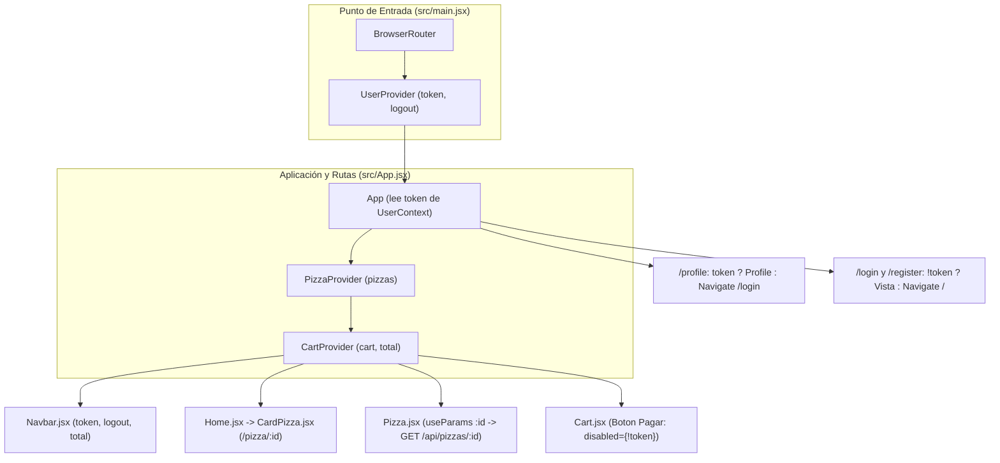

# 🍕 Pizzería Mamma Mía — Hito 7 (React Router II)

[](https://hito-7-pizzeria-mamma-mia-ashen.vercel.app/)


Aplicación web para **Pizzería Mamma Mía** desarrollada con **React + Vite**, correspondiente al **Hito 7 (React Router II)** de **Desafío Latam**. En esta etapa se implementan **rutas dinámicas** con el hook `useParams` conectadas a la API REST (`/api/pizzas/:id`), un contexto global de autenticación simulada (`UserContext`) con cierre de sesión (`logout`), validaciones de compra en el carrito y **rutas protegidas** mediante redirecciones con `<Navigate />`.

---

## 🌐 Enlaces del Proyecto

- 🚀 **Live Preview (Vercel):** [https://hito-7-pizzeria-mamma-mia-ashen.vercel.app/](https://hito-7-pizzeria-mamma-mia-ashen.vercel.app/)
- 💻 **Repositorio en GitHub:** [https://github.com/jleival/hito-7-pizzeria-mamma-mia](https://github.com/jleival/hito-7-pizzeria-mamma-mia)
- 🔌 **API Backend Catálogo (Render):** [https://pizzeria-backend-60le.onrender.com/api/pizzas](https://pizzeria-backend-60le.onrender.com/api/pizzas)
- 🍕 **API Detalle por ID (Render):** [https://pizzeria-backend-60le.onrender.com/api/pizzas/p001](https://pizzeria-backend-60le.onrender.com/api/pizzas/p001)

---

## 🎯 Objetivo del Hito 7

Profundizar en el enrutamiento dinámico y control de acceso en aplicaciones SPA utilizando **React Router DOM** y **Context API**, permitiendo:
1. Consultar dinámicamente el detalle de cualquier pizza a través de su parámetro `:id` en la URL (`GET /api/pizzas/:id`).
2. Gestionar de forma global el estado de sesión del usuario (`token` y `logout`) a través de `UserContext`.
3. Proteger vistas privadas (`/profile`), restringir rutas públicas para usuarios autenticados (`/login`, `/register`) y condicionar acciones críticas como el botón de pago en `/cart`.

---

## ✅ Requerimientos Cumplidos

| # | Requerimiento | Puntaje | Estado | Implementación |
| :---: | :--- | :---: | :---: | :--- |
| **1** | Implementar `useParams` en `Pizza.jsx` para obtener el `id`, consultar la API (`GET /api/pizzas/:id`) y mostrar la información (+ `Link` dinámico en `CardPizza.jsx`). | **2 pts** | ✅ Cumplido | Ruta `/pizza/:id` en `src/App.jsx`, navegación `<Link to={\`/pizza/${id}\`}>` en `src/components/CardPizza.jsx` y petición `fetch` dinámica con `useParams()` en `src/pages/Pizza.jsx`. |
| **2** | Crear `UserContext` con estado `token` (`true` por defecto) y método `logout` que cambie `token` a `false`. | **2 pts** | ✅ Cumplido | Creación de `UserContext` y `UserProvider` en `src/context/UserContext.jsx`, envolviendo la aplicación desde `src/main.jsx`. |
| **3** | Utilizar `UserContext` en `Navbar.jsx` para ejecutar `logout` al hacer clic en el botón Logout y alternar opciones según `token`. | **2 pts** | ✅ Cumplido | Consumo de `{ token, logout }` en `src/components/Navbar.jsx`: muestra *Profile* y *Logout* con `token = true`, o *Login* y *Register* con `token = false` (*Home* y *Total* siempre visibles). |
| **4** | Utilizar `UserContext` en `Cart.jsx` para deshabilitar el botón *"Pagar"* cuando `token` sea `false`. | **1 pt** | ✅ Cumplido | Consumo de `{ token }` en `src/pages/Cart.jsx` aplicando la propiedad `disabled={!token}` al botón de pago. |
| **5** | Implementar ruta protegida para `/profile` (redirige a `/login` si `token = false`) y bloquear `/login` y `/register` si `token = true` (redirigiendo a `/`). | **3 pts** | ✅ Cumplido | Uso de `<Navigate to="/login" />` y `<Navigate to="/" />` condicionados por `token` en las rutas de `src/App.jsx`. |

---

## 🏗️ Arquitectura de Rutas y Contextos



### Detalle de los Contextos y Rutas Dinámicas

1. **`UserContext.jsx` (Nuevo en Hito 7):**
   - **`token`**: Estado booleano inicializado en `true` por defecto para simular una sesión activa.
   - **`logout()`**: Función encargada de actualizar el estado `token` a `false`, desencadenando de forma reactiva el bloqueo del botón *Pagar*, la actualización del *Navbar* y la redirección automática de rutas protegidas.

2. **Rutas Dinámicas (`Pizza.jsx` + `CardPizza.jsx`):**
   - Cada tarjeta del catálogo construye su enlace hacia `/pizza/${id}`.
   - La vista `Pizza.jsx` extrae el identificador mediante `const { id } = useParams()` y ejecuta una consulta asíncrona al endpoint `${import.meta.env.VITE_API_URL}/api/pizzas/${id}`.

3. **Control de Acceso y Rutas Protegidas (`App.jsx`):**
   - **`/profile`**: Si `token` es `false`, redirige inmediatamente a `/login`.
   - **`/login` y `/register`**: Si `token` es `true`, impide el acceso y redirige al inicio (`/`).

---

## 📂 Estructura del Proyecto

```text
hito-7-pizzeria-mamma-mia/
├── docs/
│   └── 03_d_Hito_7_-_Pizzería_Mamma_Mía.pdf
├── public/
│   └── img/                  # Imágenes locales de respaldo (p001.jpeg - p006.jpeg)
├── src/
│   ├── assets/               # Recursos gráficos del proyecto
│   ├── components/
│   │   ├── CardPizza.jsx     # Tarjeta con Link dinámico a /pizza/:id y CartContext
│   │   ├── Footer.jsx        # Pie de página
│   │   ├── Header.jsx        # Banner principal
│   │   └── Navbar.jsx        # Navegación reactiva conectada a UserContext y CartContext
│   ├── context/
│   │   ├── CartContext.jsx   # Estado global y lógica del carrito de compras
│   │   ├── PizzaContext.jsx  # Consumo del catálogo general desde la API REST
│   │   └── UserContext.jsx   # Estado global de autenticación (token) y método logout
│   ├── data/
│   │   └── pizzas.js         # Datos iniciales simulados para el carrito (pizzaCart)
│   ├── pages/
│   │   ├── Cart.jsx          # Carrito con botón "Pagar" condicionado por token
│   │   ├── Home.jsx          # Catálogo principal de pizzas
│   │   ├── Login.jsx         # Vista de inicio de sesión (restringida si token = true)
│   │   ├── NotFound.jsx      # Página 404 personalizada
│   │   ├── Pizza.jsx         # Vista de detalle dinámico con useParams (/api/pizzas/:id)
│   │   ├── Profile.jsx       # Vista protegida de perfil conectada a logout
│   │   └── Register.jsx      # Vista de registro (restringida si token = true)
│   ├── App.jsx               # Definición de rutas dinámicas y rutas protegidas con Navigate
│   └── main.jsx              # Punto de entrada con BrowserRouter y UserProvider
├── .env                      # Variable de entorno VITE_API_URL (Backend en Render)
├── vercel.json               # Reglas de reescritura SPA para rutas en Vercel
├── package.json
└── vite.config.js
```

---

## ⚙️ Instalación y Ejecución Local

Sigue estos pasos para clonar y ejecutar el proyecto en tu entorno local:

1. **Clonar el repositorio:**
   ```bash
   git clone https://github.com/jleival/hito-7-pizzeria-mamma-mia.git
   cd hito-7-pizzeria-mamma-mia
   ```

2. **Instalar las dependencias:**
   ```bash
   npm install
   ```

3. **Verificar variables de entorno:**
   Asegúrate de contar con el archivo `.env` en la raíz del proyecto apuntando al backend:
   ```env
   VITE_API_URL=https://pizzeria-backend-60le.onrender.com
   ```

4. **Iniciar el servidor de desarrollo:**
   ```bash
   npm run dev
   ```
   Abre en tu navegador la URL indicada en consola (por defecto `http://localhost:5173`).

---

## 🛠️ Tecnologías Utilizadas

- **React 19** (`createContext`, `useContext`, `useState`, `useEffect`)
- **React Router DOM v7** (`BrowserRouter`, `Routes`, `Route`, `Link`, `Navigate`, `useParams`)
- **React Bootstrap & Bootstrap 5** (Diseño responsivo e interfaz de usuario)
- **Vite 8** (Entorno de desarrollo y empaquetador)
- **Vercel & Render** (Despliegue continuo de Frontend SPA y Backend REST API)

---

## 👨‍💻 Autor

Desarrollado por **Jorge Leiva** ([@jleival](https://github.com/jleival))  
Bootcamp **Desarrollo Full Stack JavaScript** — *Academia Desafío Latam*.
